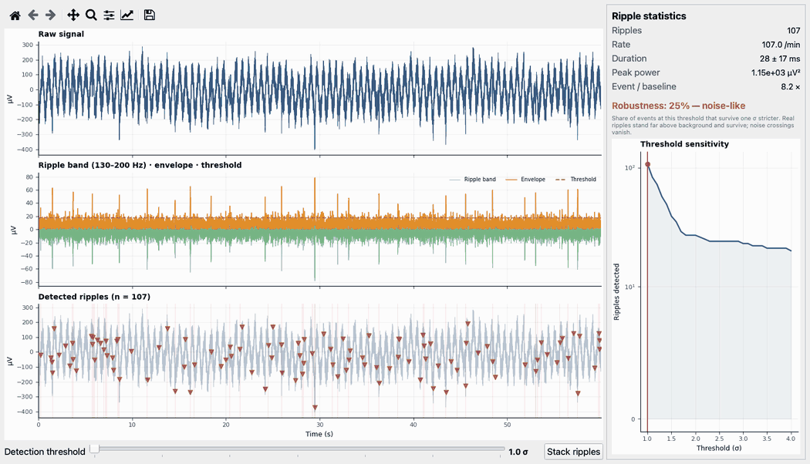
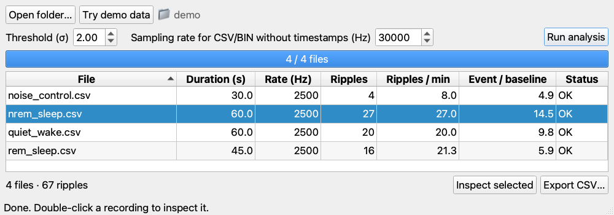
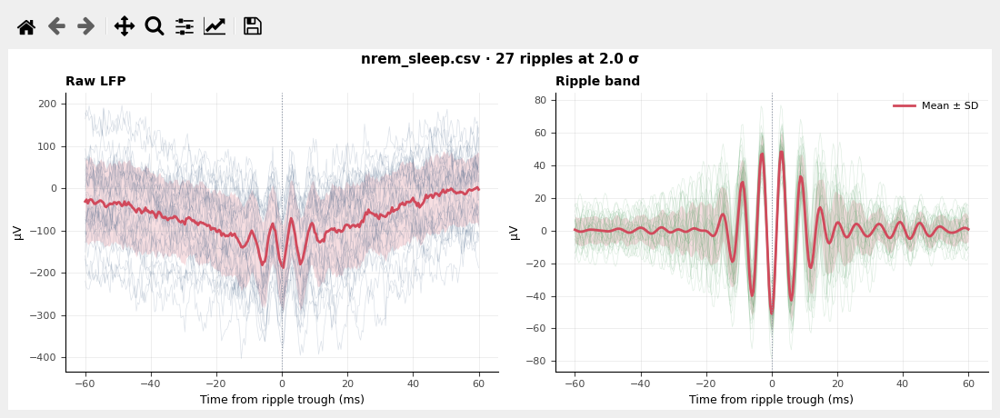

# RippleAnalyzer

[](https://github.com/radharaghu/RippleAnalyzer/actions/workflows/tests.yml)


**Detect hippocampal sharp-wave ripples in LFP recordings and see how robust each detection really is.**

Sharp-wave ripples are brief (30–100 ms), 130–200 Hz bursts in hippocampus. During rest and sleep they replay recent experience, and they are a key marker of memory consolidation. RippleAnalyzer batch-processes folders of recordings and opens any one of them in an interactive viewer. Drag the threshold and watch detections, statistics and a noise-vs-signal robustness score update live.



<sub>Sweeping the threshold from 1σ to 3σ on a synthetic NREM recording. At low thresholds the count explodes and the robustness score flags the detections as noise-like. Once the threshold clears the noise floor, the count plateaus at the real ripples.</sub>

## Highlights

- **Batch analysis** of whole folders of `.csv`, `.nwb` and `.bin`/`.dat` files, with per-file error reporting.
- **Interactive viewer** with linked raw / ripple-band / event panels, a live threshold slider and a threshold-sensitivity curve.
- **Robustness score**: the share of events that survive a 1σ stricter threshold. It separates real ripples from noise crossings without needing labels.
- **Ripple stacking**: overlay every event aligned on its deepest trough, with the mean ± SD waveform.
- **Usable without the GUI** through the Python API and the `ripple-analyzer detect` command, both scriptable.
- **Validated** against synthetic recordings with known ripple times. 24 tests run on CI.

## Quick start

```bash
git clone https://github.com/radharaghu/RippleAnalyzer.git
cd RippleAnalyzer
pip install -e ".[nwb]"
ripple-analyzer            # opens the app, then click "Try demo data"
```

<table><tr>
<td></td>
<td></td>
</tr><tr>
<td align="center"><sub>Batch results: double-click a row to inspect it</sub></td>
<td align="center"><sub>Stacked ripples aligned on the ripple trough</sub></td>
</tr></table>

## Command line and Python

```bash
ripple-analyzer detect recordings/ --sigma 2.5 -o results.csv   # file or folder
ripple-analyzer demo demo_data/                                 # synthetic recordings
ripple-analyzer gui recordings/                                 # open the app on a folder
```

```python
from ripple_analyzer import FileLoader, RippleDetector

signal, fs = FileLoader.load("session.nwb")
result = RippleDetector(fs=fs, threshold_sigma=3).detect(signal)
result["n_ripples"], result["event_bounds"][:5]    # [start, end) sample indices
```

## How it works

1. **Band-pass** 130–200 Hz (4th-order Butterworth, zero-phase).
2. **Envelope** from the Hilbert transform.
3. **Threshold** at mean + *k*·SD of the envelope (*k* is the slider).
4. **Events**: supra-threshold runs closer than 10 ms are merged, and runs shorter than 15 ms are dropped.
5. **Robustness** is the fraction of events still present at *k* + 1. The envelope of pure noise is Rayleigh-distributed, so only about 20% of noise crossings survive. Genuine ripples sit far above the floor and mostly do.

**Validation** uses four synthetic recordings with 37 known ripples in total, including a pure-noise control:

| Threshold | Real ripples found | False detections |
|-----------|-------------------:|-----------------:|
| 2σ        | 37 / 37 (100%)     | 30               |
| 3σ        | 36 / 37 (97%)      | 0                |

The trade-off is the reason the viewer exists: you can see where your own data's count plateaus.

## Supported formats

| Format | Notes |
|---|---|
| **CSV** | One sample per row. A `time`/`time_s` column sets the sampling rate automatically. Otherwise the rate is set in the app or with `--fs`. |
| **NWB** | Uses the first LFP `ElectricalSeries`. Files without voltage data (for example spike-sorted or behaviour-only sessions) get a clear explanation instead of a crash. |
| **BIN / DAT** | Raw interleaved samples. `dtype`, `n_channels`, `channel` and `fs` are configurable from Python. |

## Project layout

```
ripple_analyzer/
├── core/       detector, file loaders, batch processing  (no GUI dependencies)
├── utils/      statistics, robustness, waveform stacking
├── ui/         PyQt5 main window and interactive viewer
├── demo.py     synthetic LFP with ground-truth ripple times
└── cli.py      `ripple-analyzer` command
tests/          pytest suite (detector, I/O, statistics, headless GUI)
```

## Development

```bash
pip install -e ".[dev,nwb]"
pytest
```

## Roadmap

- Multi-channel NWB support, with a per-channel ripple heatmap
- Spectrogram and peak-frequency estimation for each ripple
- Side-by-side comparison of sessions and brain states

## License

MIT. See [LICENSE](LICENSE).
